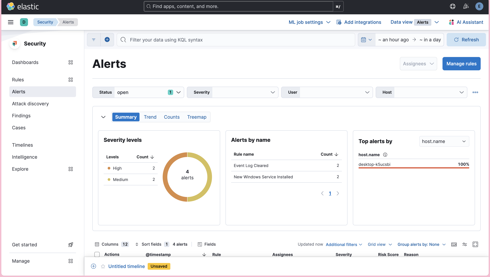

# SIEM & Detection Engineering Lab

A home security-operations lab that builds a working **SIEM**, instruments a **Windows endpoint** with security telemetry, and ships **10 MITRE ATT&CK–mapped detection rules** — each one triggered with a benign simulation of the real technique and validated firing.

Built end-to-end on a single Apple-Silicon laptop using virtualised, isolated infrastructure. The goal: demonstrate the full detection-engineering loop — **visibility → collection → detection → triage** — the way a real SOC operates.

> **Status:** SIEM live, endpoint instrumented, 10 detections built, documented, and version-controlled. Python tooling and cloud/Sentinel coverage on the roadmap.



---

## What's in here

- A **detection suite** of 10 rules across 6 ATT&CK tactics, as re-importable Elastic rules **and** a readable catalog → [`detections/`](detections/)
- Reproducible, documented **infrastructure** (VMs, networking, Elastic stack, endpoint telemetry)
- An attacker-vs-defender approach: every sensor and rule is framed by *"what does this catch, and how would an attacker evade it?"*

---

## Architecture

```
                 MacBook (host, Apple Silicon)
                 │
     ┌───────────┴───────────────────────────────┐
     │  VMware Fusion (isolated virtual lab)       │
     │                                             │
     │   ┌─────────────────┐    ┌───────────────┐ │
     │   │  SIEM VM (Linux) │   │  Endpoint VM   │ │
     │   │                 │    │  (Windows 11)  │ │
     │   │  Elasticsearch  │◄───┤  Elastic Agent │ │
     │   │  Kibana         │    │  + Sysmon      │ │
     │   │  Fleet Server   │    │                │ │
     │   └─────────────────┘    └───────────────┘ │
     │        stores + detects      generates logs │
     └─────────────────────────────────────────────┘

  Endpoint generates telemetry → Agent ships it → Fleet receives →
  Elasticsearch stores/indexes → Kibana searches + runs detection rules.
```

**Telemetry collected:** Sysmon (process creation, registry, network), Windows Security log, Windows System log, PowerShell logging.

---

## Detection coverage

10 detections mapped across the early intrusion lifecycle:

| Tactic | Detections |
|--------|------------|
| Credential Access | Brute-force failed logons (T1110) |
| Execution | Encoded PowerShell (T1059.001), Shell-from-PowerShell lineage (T1059.003) |
| Defense Evasion | Mshta LOLBin (T1218.005), Event log cleared (T1070.001) |
| Discovery | Host reconnaissance burst (T1082) |
| Command & Control | Certutil download cradle (T1105) |
| Persistence | Run-key (T1547.001), New service (T1543.003), New local account (T1136.001) |

Includes both **signature-style** rules (name/command-line matches) and **behavioural** rules (process parent-child lineage), plus **threshold** rules that aggregate bursts into single alerts.

➡️ Full logic, test triggers, and evasion notes: **[`detections/README.md`](detections/README.md)**

---

## Tech stack

`VMware Fusion` · `Ubuntu Server` · `Docker` · `Elastic Stack (Elasticsearch / Kibana / Fleet)` · `Windows 11` · `Sysmon` · `Windows Event Log` · `PowerShell` · `KQL` · `MITRE ATT&CK` · `Git`

---

## Repository layout

```
detections/   Exported detection rules (NDJSON) + documented catalog
infra/        Infrastructure build notes (VMs, networking, Elastic, endpoint telemetry)
guide/        Step-by-step build guide per phase
writeups/     (Roadmap) Attack → detect write-ups
```

---

## Roadmap

- [x] **Phase 0–1** — Isolated lab + endpoint telemetry design
- [x] **Phase 2** — Elastic SIEM deployed, endpoint logs ingested end-to-end
- [x] **Phase 3** — 10 ATT&CK-mapped detections built, validated, documented as code
- [ ] **Phase 4–6** — Python tooling (log parser, IOC enrichment, SIEM hunter) with tests
- [ ] **Phase 7–8** — Network visibility; attack-dataset replay
- [ ] **Phase 9–10** — Detection-as-code CI; mini-SOAR automation
- [ ] **Phase 11** — Microsoft Sentinel / KQL cloud track
- [ ] **Phase 12** — Portfolio polish

---

## Notes

The lab runs entirely inside isolated VMs; all adversary simulation is benign and self-contained. Built and maintained as a personal project to develop and demonstrate hands-on SOC / detection-engineering skills.
---

## Related project

**[Network Traffic Analysis Portfolio](https://github.com/Mandara-hp/network_traffic_analysis)**: five PCAP investigations with Wireshark/tshark (NetSupport RAT C2, malvertising → PowerShell C2 → TeamViewer + shellcode, port scans, DNS exfiltration, and false-positive testing against a clean baseline). Each case ends with Suricata/SIEM detection ideas, groundwork for **Phase 7–8 (network visibility)** of this lab.
