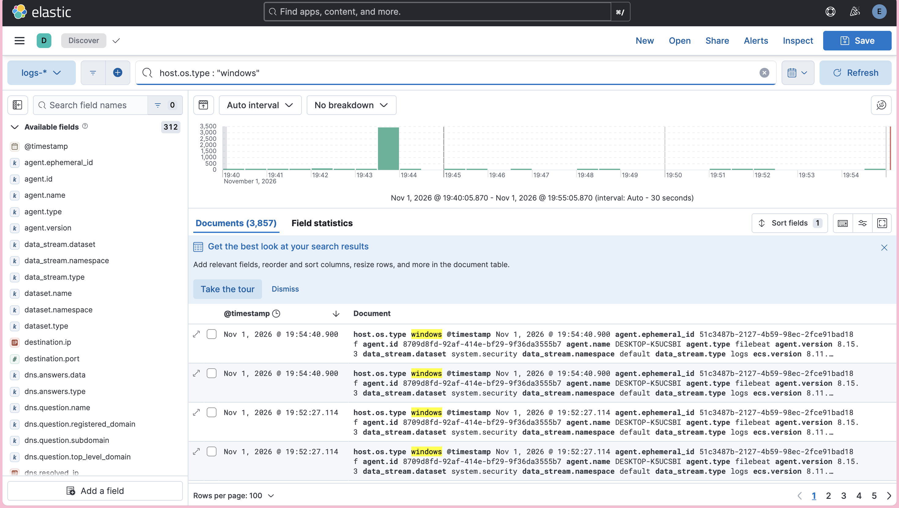
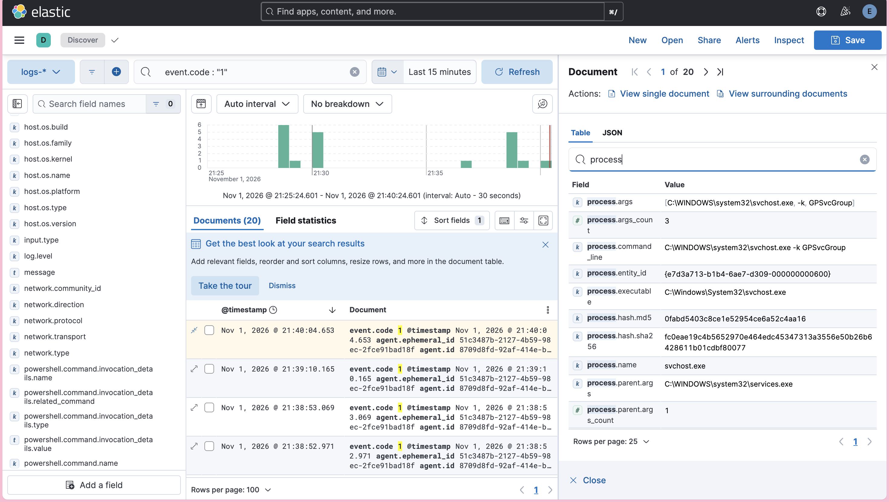
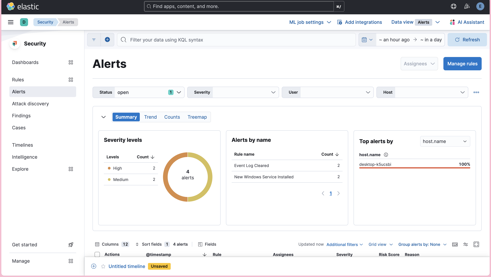
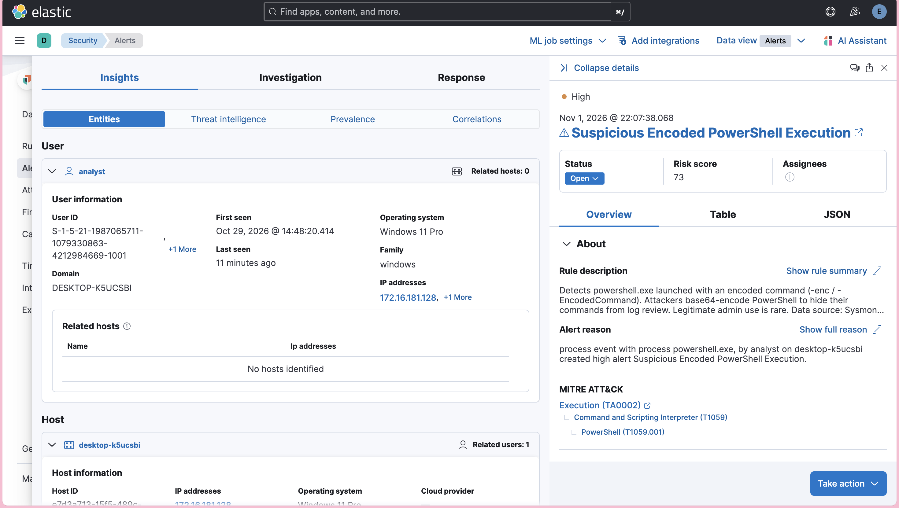

# Evidence

Screenshots captured while building and validating the lab.

## Phase 2 — telemetry pipeline working

Windows telemetry flowing into Elasticsearch from the monitored endpoint:

A single Sysmon process-creation event in Discover — full command line, parent process, and file hashes (the depth native Windows logging doesn't provide):

## Phase 3 — detections firing

Alerts raised by the detection rules on the monitored host:

An alert opened for triage — rule context, the user and host entities, and the MITRE ATT&CK mapping (Execution → T1059.001):

